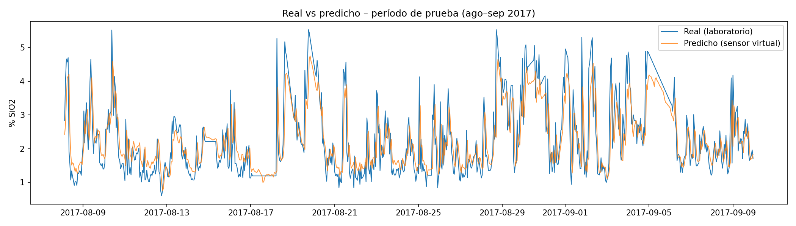
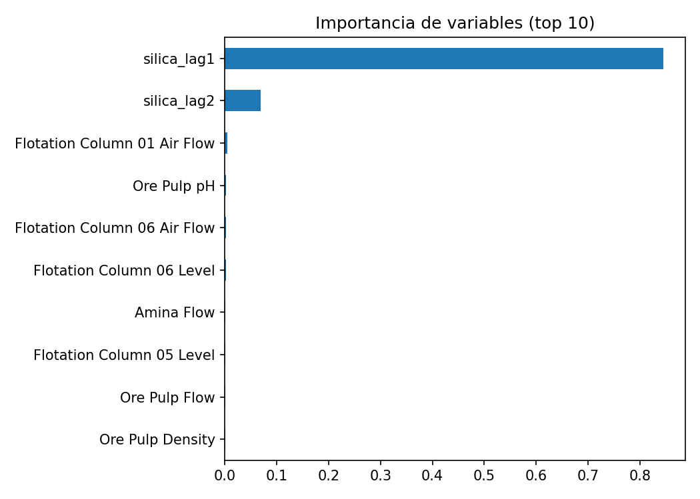

# Sensor virtual de % Sílice en concentrado de flotación

Modelo de Machine Learning para estimar la impureza de sílice (% SiO2) del concentrado de una planta de flotación de mineral de hierro a partir de variables de proceso. El objetivo es anticipar el resultado de laboratorio, que demora aproximadamente una hora, para ajustar la operación antes.

## Datos
- **Fuente:** [Quality Prediction in a Mining Process (Kaggle)](https://www.kaggle.com/datasets/edumagalhaes/quality-prediction-in-a-mining-process). Planta real, Brasil, marzo a septiembre de 2017.
- **Tamaño:** 737.453 registros y 24 variables. Las variables de proceso se registran cada 20 s y la calidad una vez por hora (laboratorio).

## Metodología
1. **Limpieza:** se detectó un hueco de 13 días sin datos y se usó solo el período continuo (29-03 al 09-09-2017).
2. **Agregación horaria:** las variables de proceso se promediaron por hora para alinearlas con la frecuencia del laboratorio. Resultado: 3.948 horas.
3. **Control de fuga de información:** se excluyó `% Iron Concentrate` (correlación −0,80), porque proviene del mismo análisis de laboratorio que se quiere anticipar.
4. **Escenarios:**
   - **A:** solo variables de proceso (sensor virtual puro).
   - **B:** variables de proceso más la última medición de laboratorio (1 y 2 h antes).
   - **C:** escenario B más variables con memoria del proceso (promedio de 3 h y tendencia).
5. **Validación temporal:** se entrenó con el 80% inicial (3.156 h) y se evaluó con el 20% final (790 h), sin mezclar al azar.
6. **Modelos:** Ridge, Random Forest y Gradient Boosting, comparados contra dos líneas base: el promedio y la persistencia (el valor de la hora anterior).

## Resultados (período de prueba)

| Modelo | MAE | RMSE | R² |
|---|---|---|---|
| Base: promedio | 0,945 | 1,150 | 0,00 |
| Base: persistencia | 0,447 | 0,721 | 0,61 |
| Random Forest, Esc. A (solo proceso) | 0,885 | 1,103 | 0,08 |
| **Ridge, Esc. B (proceso + laboratorio anterior)** | **0,478** | **0,690** | **0,64** |
| Random Forest, Esc. B | 0,511 | 0,703 | 0,63 |
| Ridge, Esc. C (+ memoria de proceso) | 0,484 | 0,693 | 0,64 |

## Conclusiones
- El mejor modelo (Ridge, escenario B) alcanza **R² = 0,64** y **RMSE = 0,69 % SiO2**. Supera a la persistencia en RMSE (−4%), lo que significa menos errores grandes.
- **Solo con variables de proceso, el R² es menor a 0,1.** Los flujos de aire, el nivel de las columnas, el pH y la amina no bastan para explicar la calidad del concentrado.
- La importancia por permutación confirma que la última medición de laboratorio domina la predicción (0,85), mientras las variables de proceso aportan poco. Agregar memoria de proceso (escenario C) no mejora el resultado.
- La relación positiva entre amina y sílice sugiere un efecto de **control reactivo**: el operador sube la amina cuando la sílice ya está alta, no al revés.

## Recomendaciones para un sensor virtual industrial
- Incorporar variables que expliquen la calidad de la alimentación: mineralogía, liberación y granulometría (P80), o un **analizador en línea**.
- Desplegar el modelo conectado al historiador de planta (por ejemplo, PI), con reentrenamiento periódico y monitoreo de deriva.
- Integrarlo en un **gemelo digital** del circuito de flotación para evaluar estrategias de dosificación de reactivos.

## Herramientas
Python: pandas, NumPy, scikit-learn y matplotlib. Ejecutado en Kaggle Notebooks.

## Autor
Christian Paillacán González, Ingeniero Civil Industrial (UTFSM), especialista en simulación de procesos mineros.
[LinkedIn](https://www.linkedin.com/in/christian-andres-paillacan)
